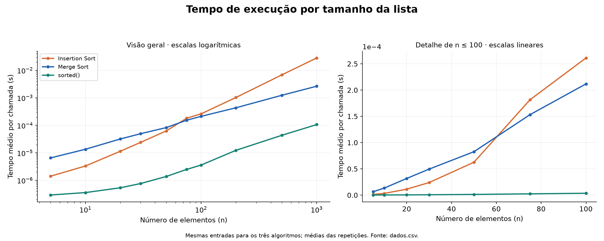
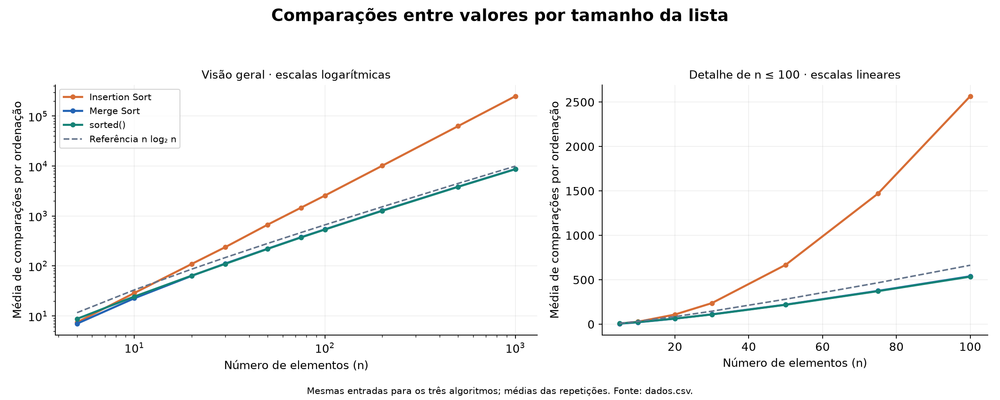

# Comparação de algoritmos de ordenação

**Integrantes:** Euclides Carlos Pilon Neto e Gabriela de Araújo Reis.  
**Disciplina:** Estrutura de Dados Avançados.  
**Execução registrada (UTC):** 2026-10-16T00:26:44.279241+00:00.

## 1. Objetivo e implementação

O trabalho compara Insertion Sort, Merge Sort e a função `sorted()` do Python.
Foram medidos o tempo de execução e o número de comparações para os dez tamanhos exigidos.
O desafio extra contabiliza as comparações do `sorted()` com uma classe que implementa `__lt__`.

No Insertion Sort, cada elemento é colocado na posição correta da parte já ordenada.
O contador aumenta antes da comparação entre a chave e o elemento anterior, inclusive quando ela é falsa.
A expressão `chave < resultado[j]` equivale a `resultado[j] > chave` para os inteiros utilizados.

No Merge Sort, a lista é dividida em duas metades e cada metade é ordenada recursivamente.
Na intercalação, comparamos os primeiros elementos ainda disponíveis e copiamos o menor.
A contagem final soma as comparações das duas chamadas e da intercalação.
Copiar a sobra de uma metade não acrescenta comparações entre valores.

As funções devolvem `(lista_ordenada, comparacoes)` e preservam a entrada.
Ambas são estáveis: elementos com a mesma chave mantêm sua ordem relativa.
O Insertion não desloca elementos iguais à chave; o Merge escolhe a esquerda em um empate.

## 2. Procedimento experimental

- Tamanhos: `[5, 10, 20, 30, 50, 75, 100, 200, 500, 1000]`.
- Repetições: **30 entradas aleatórias por tamanho**, acima do mínimo de dez.
- Semente: **20261015**, usando um gerador `Random(semente + n)` para cada tamanho.
- Cada entrada é uma permutação de `range(n)`, com valores distintos; duplicatas são cobertas nos testes.
- Os três algoritmos recebem o mesmo conteúdo em cada repetição, sem alteração da entrada.
- Há três chamadas iniciais de aquecimento por algoritmo e rotação da ordem de medição entre as repetições.
- Cronômetro: `time.perf_counter_ns()`. Medimos 50 chamadas por entrada até n = 100 e cinco acima disso.
  O tempo do lote é dividido pela quantidade de chamadas. Depois calculamos a média entre as entradas.
- A geração das listas, a contagem separada do `sorted()` e a validação ficam fora do trecho cronometrado.
- A cópia das listas e a contagem interna de Insertion/Merge estão incluídas nos seus tempos.
  O tempo de `sorted()` usa inteiros normais. Portanto, os tempos são das implementações descritas,
  e não de algoritmos abstratos com todos os custos igualados.
- `dados.csv` conserva uma linha bruta por algoritmo/entrada e uma linha de média por algoritmo/tamanho.
  O desvio padrão é amostral. Repetir a semente reproduz as entradas e contagens neste ambiente,
  mas não torna os tempos idênticos.

**Ambiente efetivo:** CPython 3.14.2;
Windows-11-10.0.26200-SP0; processador informado: Intel64 Family 6 Model 158 Stepping 9, GenuineIntel;
Matplotlib 3.11.2. Os detalhes estão em `ambiente.json`.
Os resultados descrevem esse ambiente, sem atribuí-los ao computador pessoal dos integrantes.

## 3. Tabela de resultados

Valores apresentados como **média ± desvio padrão amostral**. A tabela converte segundos para
microssegundos (1 µs = 10⁻⁶ s); o CSV e o gráfico de tempo usam segundos.
Uma contagem individual é inteira e exata. Sua média entre diferentes listas pode ser fracionária.

| n | Insertion: tempo (µs) | Merge: tempo (µs) | sorted: tempo (µs) | Insertion: comparações | Merge: comparações | sorted: comparações |
|---:|---:|---:|---:|---:|---:|---:|
| 5 | 1.413 ± 0.466 | 6.533 ± 3.017 | 0.292 ± 0.274 | 7.43 ± 1.81 | 7.00 ± 0.87 | 8.73 ± 1.55 |
| 10 | 3.318 ± 0.784 | 13.469 ± 2.559 | 0.358 ± 0.184 | 28.80 ± 5.93 | 22.57 ± 1.61 | 24.43 ± 1.30 |
| 20 | 11.400 ± 4.026 | 31.808 ± 6.154 | 0.535 ± 0.185 | 109.77 ± 13.01 | 63.37 ± 2.51 | 64.10 ± 2.01 |
| 30 | 23.997 ± 5.825 | 49.581 ± 5.494 | 0.762 ± 0.097 | 238.27 ± 26.97 | 111.83 ± 2.59 | 110.20 ± 2.48 |
| 50 | 62.621 ± 6.648 | 82.721 ± 8.202 | 1.379 ± 0.279 | 669.40 ± 67.12 | 221.27 ± 4.71 | 219.37 ± 2.94 |
| 75 | 181.521 ± 80.330 | 153.167 ± 31.819 | 2.490 ± 0.946 | 1471.07 ± 105.45 | 376.20 ± 5.39 | 372.87 ± 3.09 |
| 100 | 261.219 ± 26.606 | 211.783 ± 78.138 | 3.590 ± 1.118 | 2567.50 ± 170.66 | 540.30 ± 4.76 | 535.97 ± 4.99 |
| 200 | 1026.833 ± 89.581 | 434.175 ± 57.660 | 12.312 ± 4.552 | 10149.33 ± 560.92 | 1282.43 ± 7.81 | 1271.63 ± 6.68 |
| 500 | 6855.595 ± 806.027 | 1240.056 ± 136.716 | 43.453 ± 5.735 | 62978.50 ± 1918.88 | 3855.57 ± 13.55 | 3834.13 ± 9.94 |
| 1000 | 28208.867 ± 1916.934 | 2643.639 ± 216.877 | 106.480 ± 19.140 | 250788.80 ± 3952.66 | 8703.60 ± 17.45 | 8656.37 ± 13.41 |

## 4. Gráficos

O painel da esquerda usa escalas logarítmicas para mostrar todos os tamanhos e curvas.
O painel da direita usa escalas lineares e destaca as listas pequenas.
As linhas ligam os pontos medidos e não representam medições dos valores intermediários.
A linha n log₂ n é uma referência de crescimento, não um mínimo exato por entrada.

## 5. Em qual n o Merge passa a ser mais rápido?

O primeiro tamanho testado com média menor para o Merge Sort foi **n = 75**. A mudança observada está entre os pontos amostrados n = 50 e n = 75. Os inteiros intermediários não foram medidos; não é possível apontar uma fronteira exata nesse intervalo. A vantagem continuou nos demais tamanhos amostrados.

Esse é o valor observado entre os tamanhos exigidos pelo enunciado. Um limiar exato e universal
não pode ser obtido com essa amostragem: o hardware, a execução e o código influenciam os tempos.
Para investigar o intervalo, seria necessário medir também seus valores intermediários e repetir
o experimento. Diferenças pequenas devem ser avaliadas junto com a dispersão; não foi realizado
um teste de significância estatística.

## 6. Os gráficos apresentam a mesma virada?

O primeiro tamanho testado com média menor para o Merge Sort foi **n = 5**. Ele já teve vantagem no menor tamanho da amostra; uma virada anterior não foi observada. A vantagem continuou nos demais tamanhos amostrados.

Nesta execução, os pontos não coincidiram: **tempo em n = 75** e **comparações em n = 5**.

Contar comparações e medir tempo descrevem aspectos diferentes. O tempo inclui movimentação de
elementos, criação de listas, chamadas recursivas, controle dos laços e atualização dos contadores.
O Merge pode economizar comparações, mas gastar mais tempo com essas outras operações em listas
pequenas. A decisão deve usar os dados observados, sem assumir previamente que as viradas coincidem
ou que ocorrem em um tamanho fixo.

## 7. Por que sorted() não decide sozinho qual algoritmo é mais eficiente?

O `sorted()` é uma referência prática do recurso disponível na linguagem. No CPython, sua
implementação nativa otimizada em C difere das nossas funções escritas em Python.
Ela é adaptativa e aproveita trechos ordenados. A documentação a descreve como Timsort;
versões modernas do CPython também usam a estratégia Powersort para decidir a ordem das intercalações.

Assim, essa medição mistura algoritmo, implementação e otimizações. Uma vantagem do `sorted()`
não prova, por si só, que nossa versão do Insertion ou do Merge tem determinada complexidade.
A análise dos dois algoritmos próprios considera suas comparações, o crescimento com n e os custos
de suas implementações. Além disso, eles contabilizam comparações durante a medição; o `sorted()`
com inteiros não executa o contador Python do desafio nesse trecho.

## 8. Quando o Insertion Sort é adequado?

Um exemplo é inserir um novo registro em uma pequena lista que já está ordenada, como uma lista
de pontuações. Se o novo registro está próximo de sua posição final, poucos deslocamentos bastam.
Também pode ser usado para ordenar pequenos blocos dentro de algoritmos híbridos.

Para esta implementação, o custo do Insertion pode ser descrito por Θ(n + I), em que I é o número
de inversões. No melhor caso, há n − 1 comparações para n ≥ 1; no pior caso, com valores distintos
em ordem inversa, há n(n − 1)/2. O caso médio com permutações uniformes é Θ(n²).
Dados quase ordenados aproximam-se do caso linear quando a quantidade de inversões é O(n);
o rótulo “quase ordenado” sozinho não garante esse limite.

O Merge implementado tem tempo Θ(n log n) no melhor, médio e pior caso, para n crescente,
com memória auxiliar de pico O(n). Listas e chamadas recursivas explicam parte de seu custo constante.
Não existe um tamanho fixo abaixo do qual Insertion é sempre a melhor escolha em todo computador.

## 9. Desafio extra: comparações do sorted()

Cada valor é envolvido em `ElementoContador`. O método `__lt__` incrementa uma variável de classe
e compara os valores internos. O contador é zerado antes de cada ordenação e lido ao final.
Essa execução é separada da cronometragem com inteiros. A contagem é exata para a ordenação dos
objetos instrumentados; não foi inserido um contador dentro da implementação nativa para inteiros.

| n | sorted: média de comparações | n log₂ n | log₂(n!) | sorted / (n log₂ n) |
|---:|---:|---:|---:|---:|
| 5 | 8.73 | 11.61 | 6.91 | 0.752 |
| 10 | 24.43 | 33.22 | 21.79 | 0.736 |
| 20 | 64.10 | 86.44 | 61.08 | 0.742 |
| 30 | 110.20 | 147.21 | 107.71 | 0.749 |
| 50 | 219.37 | 282.19 | 214.21 | 0.777 |
| 75 | 372.87 | 467.16 | 363.40 | 0.798 |
| 100 | 535.97 | 664.39 | 524.76 | 0.807 |
| 200 | 1271.63 | 1528.77 | 1245.38 | 0.832 |
| 500 | 3834.13 | 4482.89 | 3767.35 | 0.855 |
| 1000 | 8656.37 | 9965.78 | 8529.40 | 0.869 |

Para n valores distintos, uma árvore binária de decisões precisa distinguir n! permutações.
Seu pior caso tem pelo menos ⌈log₂(n!)⌉ comparações; sob permutações equiprováveis, a média
tem limite inferior log₂(n!). Isso produz o limite assintótico Ω(n log n).
Não significa que toda entrada precise de n log₂ n comparações, nem que cada decisão reduza
as possibilidades exatamente pela metade. Uma entrada já ordenada pode exigir apenas O(n)
comparações em uma ordenação adaptativa.

Por isso, uma contagem abaixo de n log₂ n não contradiz o limite teórico. A tabela apresenta as
duas referências e a razão observada, sem presumir que o resultado será igual ao limite.
O experimento principal usa listas aleatórias; não mede separadamente o benefício de longos
trechos previamente ordenados. Para estudar esse benefício, seria preciso acrescentar esse cenário.

## 10. Síntese dos resultados

No maior tamanho medido, n = 1000, a razão tempo(Insertion)/tempo(Merge) foi **10.67**,
e a razão entre suas médias de comparações foi **28.81**.
Razões acima de 1 indicam maior custo do Insertion nesse indicador; abaixo de 1, maior custo do Merge.
A leitura conjunta das tabelas e gráficos permite relacionar o crescimento quadrático da inserção
ao crescimento n log n da intercalação, respeitando as limitações do experimento finito.

## 11. Verificação e reprodução

Execute `python -m unittest testes.py -v` para verificar os cinco casos obrigatórios e os casos
adicionais de contagem, estabilidade, entradas com repetição e permutações pequenas.
Execute `python medir.py` para refazer o CSV, os gráficos, o registro do ambiente e este relatório.
O programa valida a ordenação fora do trecho cronometrado em cada medição.

O relatório é gerado pelo arquivo `relatorio.py`: alterações de análise que devam permanecer
após uma nova execução precisam ser feitas nesse gerador. Os nomes dos integrantes são os
informados pela dupla; a autoria dos commits será registrada quando cada um revisar e enviar
sua etapa no próprio Git.

## 12. Referências e escopo

- Enunciado e guia fornecidos em `atividade_e_instrucoes.md`. As conclusões sugeridas pela IA
  foram substituídas por análises condicionadas aos resultados. As atribuições às Aulas 10 e 11
  não foram verificadas diretamente nos slides para esta versão.
- Python: [Sorting Techniques](https://docs.python.org/3/howto/sorting.html).
- CPython: [notas de implementação da ordenação](https://github.com/python/cpython/blob/main/Objects/listsort.txt).
- Python: [time.perf_counter_ns](https://docs.python.org/3/library/time.html#time.perf_counter_ns).

A discussão sobre tabelas hash foi omitida por não ser necessária às perguntas da atividade.
